# Raytracing Engine

Raytracing engine developed in C++, OpenGL.

View the PDF report [here](Final%20Report.pdf).

## 1. Members

This is the computer graphics final project report. The (3) members of the group are omitted for privacy.

## 2. Introduction

The goal of this report is to present the features we implemented in the final project. For each implemented feature, there is the purpose of the feature, the logic behind the feature (all of the methods are explained extensively) and the way of debugging the feature visually in order to verify that the logic behind it is correct.

## 3. Standard Features

### 3.1 Shading

Shading allows us to compute the color at an intersection point in an object based on several parameters such as the material's original color, the angle relative to the light and the camera...

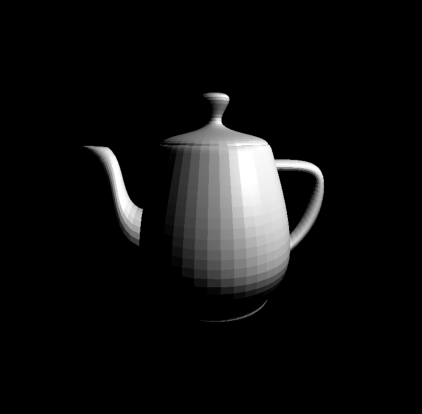

_Figure 1.1_

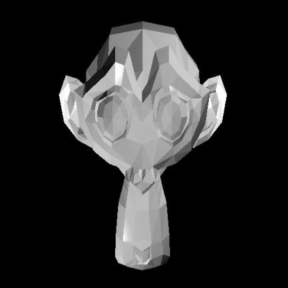

_Figure 1.2_

#### Implementation:

In this case, we are using the Phong illumination model, which is made up of three components (ambient, diffuse and specular). The final color will be the sum of these. In this case, we will omit the ambient term, since this will be implemented in other parts of the project.

To calculate the diffuse component, we can use the formula:

$$
D = l_d K_d \cos(\alpha) = l_d K_d (\vec{l} \cdot \vec{n})
$$

- $l_d$: Light color.
- $K_d$: Material diffuse property.
- $\vec{l}$: Normalized light direction (from the intersection point).
- $\vec{n}$: Normalized surface normal vector.

Similarly, to obtain the specular component, we use:

$$
S = l_s K_s \cos(\alpha)^s = l_s K_s (\vec{r} \cdot \vec{v})^s
$$

- $l_s$: Light color.
- $K_s$: Material shininess property.
- $\vec{r} = 2(\vec{l} \cdot \vec{n})\vec{n} - \vec{l}$: Reflection vector.
- $\vec{v}$: Normalized view direction vector (from the camera to the intersection point).

When shading is disabled, no illumination will be taken into account (Figure 1.3), and the resulting color will be the Kd (diffuse property) of the corresponding material. The opposite is illustrated in figures 1.1, 1.2 and 1.4 (Shading enabled), where certain triangles of the mesh will be darker if they are not directly facing the source light. Note that for shading to work, the normal of the _hitInfo_ should be updated to that of the triangle it hits.

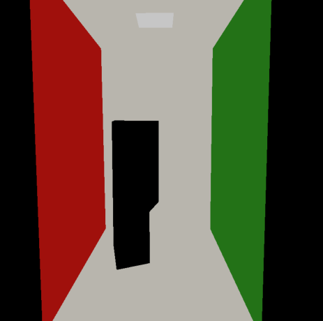

_Figure 1.3 (Shading disabled)_

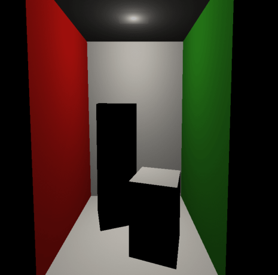

_Figure 1.4 (Shading enabled)_

#### Visual Debug:

The visual debug for shading consists in casting a ray from the camera to the intersection position by pressing “r” and setting its color to that computed by the shading algorithm. This way we can clearly see the shaded color at each intersection point. This is performed in the _getFinalColor()_ method inside _render.cpp_ , where we draw a ray with the computed color. This can be seen in figures 1.5 and 1.6, where a green and white ray is drawn representing the shaded color.

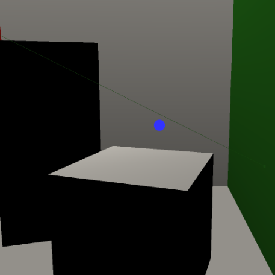

_Figure 1.5 (Green ray)_

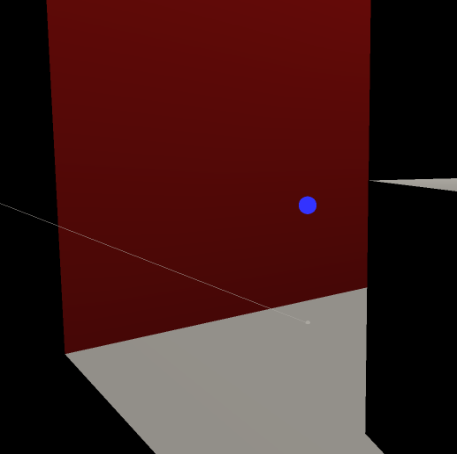

_Figure 1.6 (White Ray)_

### 3.2 Recursive Ray-Tracer

The recursive ray-tracer allows for objects with specular surfaces to be rendered more realistically and reflect light coming from other objects and thus mirror its surroundings.

#### Implementation:

When the triangle which the ray hits and will be rendered is found (if there is one, of course) we check the properties of the material of the mesh it belongs to. More specifically, we check if the specular reflection constant Ks is not black -  (0, 0, 0). When that is the case, that means a reflected ray will contribute additional light. We introduce a loop in the method that computes the final color of a pixel, which follows the ray shot from the camera view throughout all of its reflections until it finally hits a non-reflective surface. The light contribution at all of the intersection points is computed as before, all of the values are summed and that is the final color at the first interaction point - the one of the original ray with the scene. A helper method is implemented to compute the reflected ray when given the original one and the normal vector of the triangle at the intersection point. The following formula[4] is used for this computation:

$$
\vec{r} = \vec{v} - 2(\vec{v} \cdot \vec{n})\vec{n}
$$

Where:

- $\vec{r}$ is the reflected ray.
- $\vec{v}$ is the original ray.
- $\vec{n}$ is the normal vector of the triangle's plane.

After the reflected ray is computed, it is passed to the getFinalColor() method, which uses it to compute the additional color values as described before. It should be noted that before tracing whether this reflected ray intersects any triangles, it is shifted a bit towards its direction vector. The shift is performed by moving the origin of the ray by adding the vector 0.0001 * ray.direction. The value 0.0001 was chosen because it performed well enough to help avoid any noise. That modification is needed because of the nature of floating-point operations. When calculating the origin of the reflected ray (which is the original intersection point), it may happen that the point lays “behind” the surface of the triangle. Thus, when checking which, if any, triangles it intersects, some rays will “intersect” the plane they originate from, which would lead to graininess of the image.

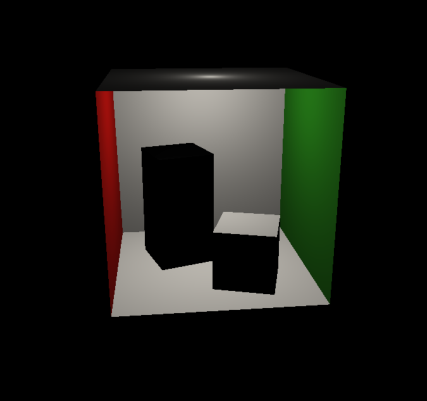

_Figure 2.1 Rendered image without the ray tracing_

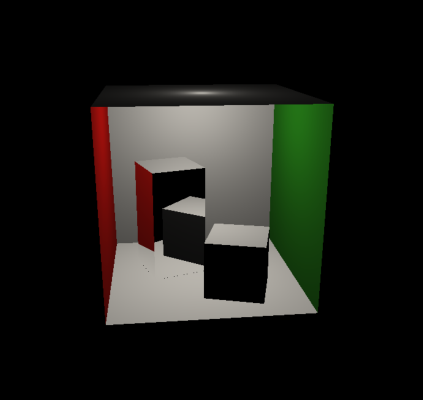

_Figure 2.2_

_Rendered image with the ray tracing enabled_

#### Visual Debug:

The visual debug for the recursive ray-tracer consists of showing the “path” a ray takes - so displaying all of its reflections. All of the rays are recursively drawn in the method getFinalColor() in render.cpp. The following images depict how it works:

- Figure 2.3: A ray, shot from the camera view is shown in black - the color of that particular pixel. The ray shown in red is its reflection and it is colored that way, because it does not intersect anything in the scene. That also explains the final color of the original intersection point (and thus the ray) - this particular point of the mirror surface does not reflect anything of the surrounding objects and thus is the color of the empty space around the cube - black.

- Figure 2.4: A ray, shot from the camera view is shown in gray - the color of that particular pixel. It is being reflected on the top side of the rectangular cuboid and intersects the gray wall of the outer cube - this giving the color of the original intersection point. Since the material of the “”wall” is not specular, the ray isn’t being reflected any further.

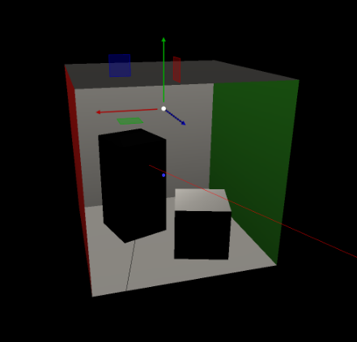

_Figure 2.3_

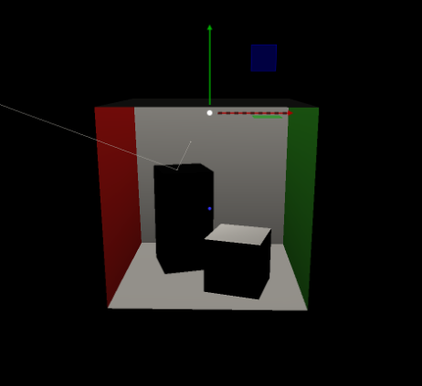

_Figure 2.4_

### 3.3 Hard Shadows

Hard shadows are a feature implemented to work with point light sources. For each point that is rendered in the final image, it is evaluated whether it is illuminated by any of the point lights contained in the scene. If not - the point remains black.

#### Implementation:

To conduct the aforenamed evaluation, “shadow rays” are constructed, which point from the intersection point in question towards the point light sources. If such a ray intersects any object from the scene before reaching  the light, then the intersection point is “in shadow” and the point light source doesn’t contribute to its final color. The method testVisibilityLightSample() in file light.cpp does this check and if the feature Hard shadows is enabled, it is being called in the method that calculates the illumination of each light source for the particular point - computeLightContribution() in light.cpp. Only if the point is not in shadow for a light source is its contribution added when the final color is calculated in getFinalColor().

It is important to note that similarly to as we did in the implementation of recursive ray tracing, once again the ray we are working with (the shadow ray) must be shifted. Otherwise it might turn out that because of floating-point calculations the origin of the shadow ray is a bit behind the surface it originates from and thus this intersection point  would appear to be in shadow, even though it may not be. The shift is performed by moving the origin of the shadow ray by adding the vector 0.0001 * ray.direction. The value 0.0001 was chosen because it performed well enough to help avoid any noise.

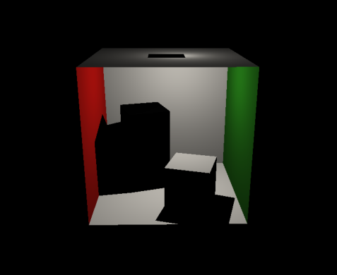

_Figure 3.1 - Hard shadows enabled for a single point light source_

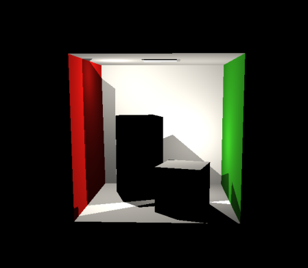

_Figure 3.2 - Hard shadows enabled for two point light sources_

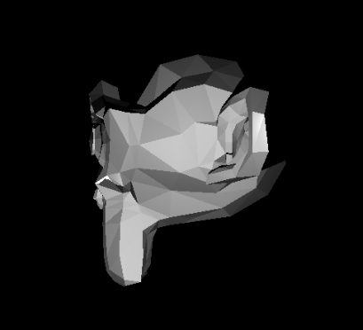

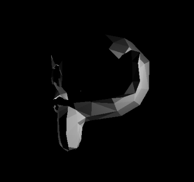

_Figure 3.3 - Hard shadows enabled - different positions of a single point light source_

#### Visual Debug:

The visual debug for hard shadows consists of drawing the shadow ray from the intersection point of the ray, shot from the camera view, and the scene. If this shadow ray does not intersect anything else on its way and reaches the light, then it is colored in the color of the point light source. If it does however hit anything else (thus the original point is in shadow), then this intersection point of the shadow ray is drawn at its end and it is colored in red.

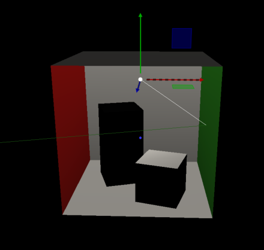

_Figure 3.4_

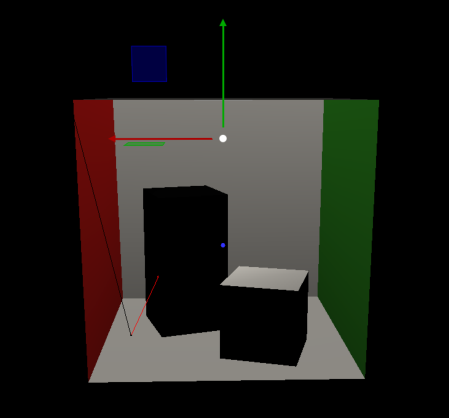

_Figure 3.5_

- Figure 3.4: A ray is shot from the camera view. It is colored in green, because this is the color this particular intersection point will be when the image is rendered. This is being proved by the constructed shadow ray (in white) - it does not intersect anything between the intersection point and the light source. Thus, we clearly demonstrate the point is not in shadow and the light illuminates it.

- Figure 3.5: A ray is shot from the camera view. It is colored in black, because this is the color this particular intersection point will be when the image is rendered, since it is in shadow. We can help visualize this by constructing the shadow ray in red. It clearly hits another surface and does not reach the light, thus the intersection point is “invisible” to it and no light contribution is added.

### 3.4 Area Lights

Area lights allow us to compute the light contribution at an intersection point coming from light sources that extend in one or more directions. This feature enables us to have soft shadows, since points gradually become darker as less part of the light source is visible (Figure 4.1).

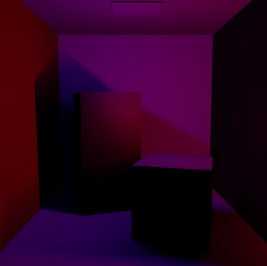

_Figure 4.1 (Segment light rendered with 50 samples)_

#### Implementation:

Area lights are implemented by casting multiple rays from the intersection point to a point in the light source and averaging the contribution from each ray.

This technique is called sampling and can be done in multiple ways. We could always cast rays to the same points of the light source (uniform sampling) or to random points instead (random sampling). In this project, a combination of both is used.

Instead of casting rays to completely random points inside the light, we divide the segment or parallelogram in n equal parts (which can be increased or decreased to improve rendering times) and then choose a random point inside each. This is called jittered sampling.

Once we have a random point, its color is calculated by using linear (segment lights) or bilinear interpolation in the case of parallelogram lights.

##### Segment lights

Segment lights consist of two endpoints and two colors. Since we are going to calculate a random point by interpolating between two positions, we can give each a different weight. These weights will be in the range [0,1] and the sum of both will always be equal to 1. This is illustrated in figure 4.2, where the weights for point 2 are defined under a segment with 4 partitions. In this case, the selected random point’s position is a combination of 60% of point 1 and 40% of point 2.

In order to divide the segment in n equal parts, we will first have to calculate the length of each division using:

$$
\text{Partition size} = 1 / \text{Segment length}
$$

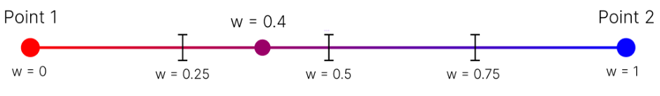

_Figure 4.2_

Each partition is bounded by a minimum and maximum weight. In the case of the segment where the selected point is in figure 4.2, any random point selected inside will have weights between 0.25 and 0.5. We can now define a list that contains each partition’s minimum and maximum weight by looping n times starting with minimum weight = 0 and adding the partition size with each iteration. The last segment’s maximum weight should be 1 and its minimum weight = 1 - partition size.

Thus, we can now loop over this list and in each iteration choose a random number between each partition’s corresponding minimum and maximum weight. The final position can be defined by:

$$
P = w P_0 + (1-w)P_1
$$

Furthermore, we can use this same weight to calculate the final color by using linear interpolation between these points:

$$
C = w C_0 + (1-w)C_1
$$

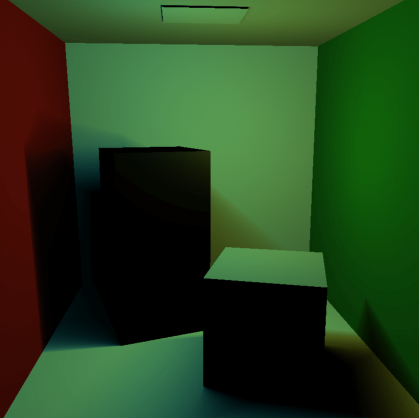

_Figure 4.3 (Segment light rendered with 100 samples)_

##### Parallelogram lights

Parallelogram lights sampling works in the same way as previously described. The difference is that we now have a 2D grid instead of a 1D segment. Thus, instead of calculating one random weight, we have to compute another random weight for the y axis.

Since a parallelogram is made up of one origin point and two edges (Figure 4.4), we can treat these edges as two different segments and apply a similar method as with segment lights.

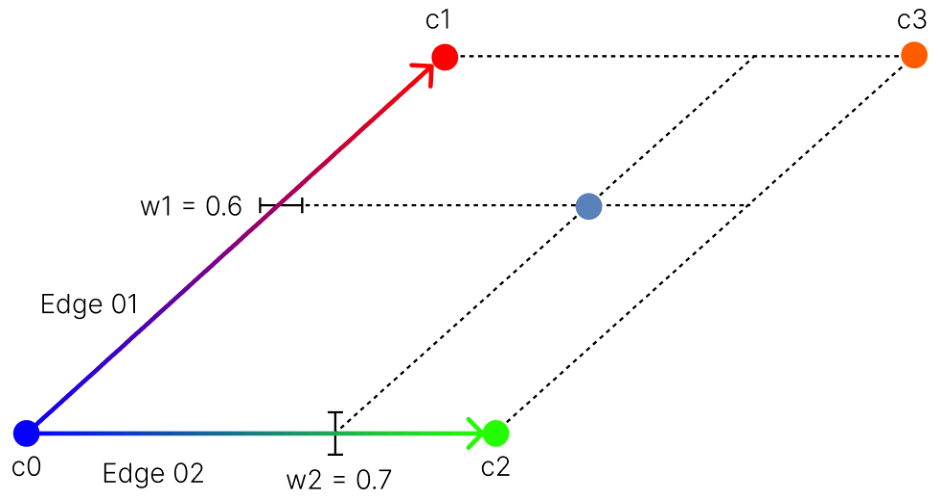

_Figure 4.4_

By dividing each edge into n parts, we will create a uniform grid inside the parallelogram, inside which we can sample random points. Thus, the number of samples taken is equal to $n^2$.

We first define the list of weights as previously described, and then calculate two random weights between their respective minimum and maximum values. Since an edge is a vector, each weight will modify its length. We can define our final point’s position with:

$$
P = O + w_1\vec{e}_{01} + w_2\vec{e}_{02}
$$

With this position, the final color can be computed by using the bilinear interpolation formula between four colors situated at the vertices of the parallelogram:

$$
C = ((1-w_2)C_0+w_2C_2)(1-w_1)+((1-w_2)C_1+w_2C_3)w_1
$$

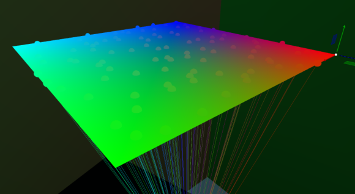

_Figure 4.5 (Bilinear interpolation)_

Note that sampled points only contribute to the final color if they are visible from the intersection point.

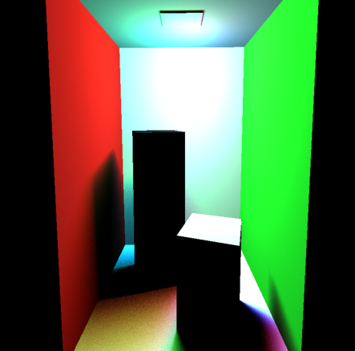

_Figure 4.6 (Parallelogram light rendered with 25 samples)_

#### Visual Debug:

The visual debug for area lights consists in displaying the rays casted from the intersection point to the sampled points in the light and setting the colors to their corresponding interpolated color (Figure 4.7 and 4.8).

This is implemented in the method _visualDebugSoftShadows()_ in _draw.cpp_.

Rays that are blocked and do not reach the surface of the light source are displayed in red (Figure 4.7 and 4.8).

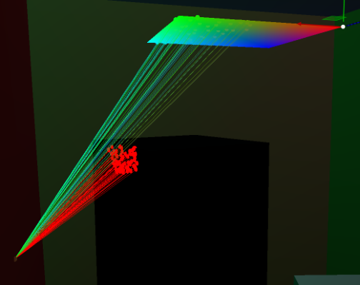

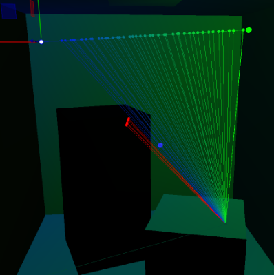

_Figure 4.7 / Figure 4.8_

_Figure 4.9_

### 3.5 Acceleration Data Structure

#### 3.5.1 Generation
Why do we need Acceleration Data Structures, and particularly Bounding Volume Hierarchy? Because it simplifies the tests on the objects and results in significant performance improvement. The time complexity is basically reduced to logarithmic in the number of objects.

#### Implementation
A triangle Triangle struct that stores:

- Vertex v0 - the first vector of the triangle

- Vertex v1 - the second vector of the triangle

- Vertex v2 - the third vector of the triangle

Its constructor takes 3 vertices as parameters

Then there is another struct ,Node, that stores:

- Boolean isLeaf that indicates whether the node is a leaf node or an internal node

- An Axis-aligned box that indicates the boundaries of the node (the Axis-aligned box is a default struct that stores the lower bounds and the upper bounds of the box)

- Indices of the left and the right children

- A list that contains the indices of the triangles

- An integer value of the level of the node in the hierarchical structure ()

- An integer value for the axis that the node should be divided by (0 for the x-axis, 1 for the y-axis and 2 for the z-axis)

The method that is used to identify the triangles is called get_triangle() and it takes 2 parameters - the index of the wanted triangle and the corresponding scene. It loops through all of the meshes in the loop and finds the triangle that is stored in the list of triangles in the Mesh. Then the method returns a Triangle with vertices that are mapped from the found triangle.

Its constructor is a little bit more complex. As parameters it takes a list of ints which is for the indices of the triangles, a level, an axis, a list of Nodes (which is provided as a field in the Bounding Volume Hierarchy struct) and a scene of type Scene.

The axis is assigned to the provided axis in the method signature. Same goes for the level. The bounds are computed in a method called computeAABB(), that takes the triangle indices and the scene as parameters, calculates the lowest x, y and z as a vector and the highest x, y and z as a vector, and returns a AABB that is defined by these 2 vectors. After that, there is a condition that checks if the triangles provided are more than 10. If they are more than 10:

The triangles are sorted according to the provided axis. The method that does that is called sortAccordingToAxis() and takes the triangles, the axis and the scene. The body of the method is a switch statement and its value is the reminder of the axis divided by 3. According to the axis, it sorts all the triangles. After they are sorted we take the first n/2 (if the number of triangles is n) as left triangles and the rest as right triangles. We use these triangles to create the left node first and then the right node (pre-order). After the creation of the children, the nodes are pushed in the node list, provided in the signature of the method, and their index is set right before pushed. The boolean value is assigned to false. Else the triangles are assigned to the provided triangles and the boolean value is set to true.

Since we have the Node constructor, that allows the BVH constructor to be implemented. It is as follows:

The constructor has the scene as a parameter. From it, we can create a list that contains all of the indices of the triangles in the mesh (from 0 to n, where n is the number of the triangles). After that we initialize the root node with the list of triangles, level 0, axis 0 (x-axis) and the list of nodes (recursively the other nodes are created). After that the root node is inserted in the list of nodes.

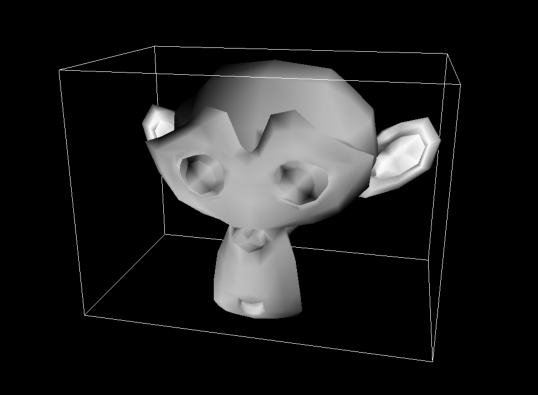

The root node of the tree (Monkey)

#### Visual Debug:

Let us start with numLevels() and numLeaves(). These methods are used in order to calculate the number of levels and the number of leaves. They allow us to look at the different levels of the hierarchy, and respectively, each of the leaves. They can be seen in the UI when the program is run. The method used to debug the draw level is called debugDrawLevel() and takes the level as a parameter. Respectively, for each level the Axis-aligned box for the level is drawn.

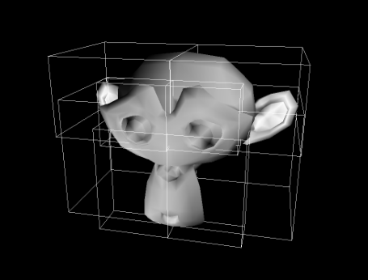

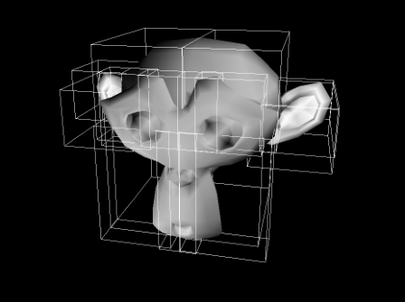

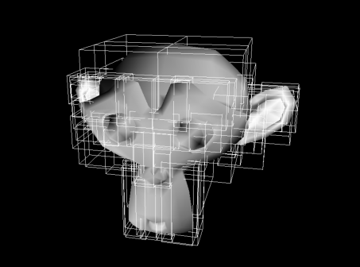

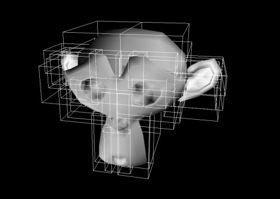

Level 3, 4, 5 and 6 of the BVH structure respectively (Monkey)

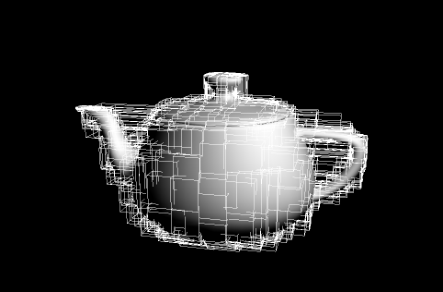

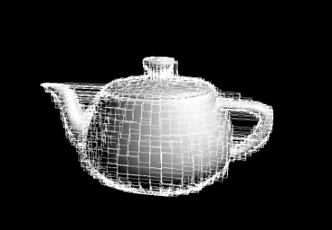

Level 9 and 11 of the BVH structure (Teapot)

The method that visualizes the leaves is called debugDrawLeaf(), which takes the index of the wanted leaf. It loops through all nodes and when the wanted one is found, the Axis-aligned box and the triangles inside it are drawn.

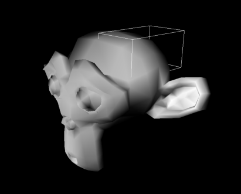

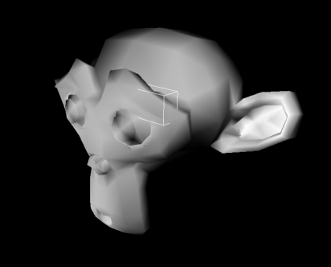

2 leaf nodes in the Monkey mesh

#### 3.5.2 Traversal - not implemented
We don’t have a comparison table, since we don’t have a traversal and the time to render would be the same

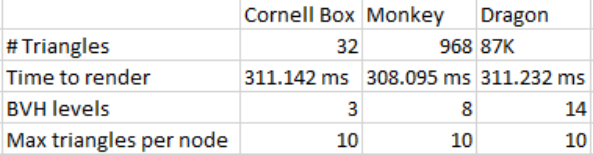

These results are default (without traversal)

### 3.6 Barycentric Coordinates for Normal Interpolation

Barycentric coordinates are extremely useful when studying properties of a triangle without knowing any information about the angles. They are quite useful in the implementation of textures.

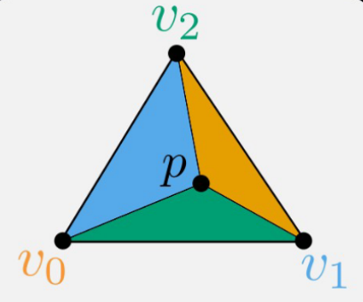

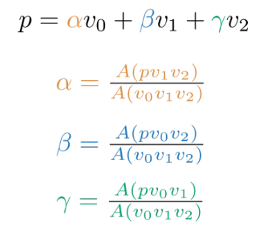

Figure 6.1 / Figure 6.2

In Figure 6.1, we can see that the triangle is divided in 3 smaller triangles. The barycentric coordinates are computed by dividing the area of the triangle opposite to a vertex to the area of the big triangle (as the formulas in Figure 6.2)

#### Implementation:

The method that returns the barycentric coordinates is called computeBarycentricCoord() and it takes three vectors (the points of the triangle) and a point p, for which the barycentric coordinates are computed. We are deriving the area of the small triangles by taking the length of the cross product of the two vectors that define the triangle for each vertex. To compute the coordinates, we have to divide these areas to the area of the big triangle (as shown in Figure 6.2), which is computed in the same way. Then the values are returned as a vector.

The normals are interpolated using the method interpolateNormal(), which takes 3 normals and a vector of barycentric coordinates. In its body, each of the normals is multiplied by the corresponding barycentric coordinate and then all of them are summed. The result is a 3-dimensional vector.

#### Visual Debug:

For the visual debug we are using 2 methods. The first one draws a normal and the second one uses it to draw all the normals of the vertices of the triangle and the normal of the point inside the triangle.

The first method is called drawNormal() and it takes a vertex and a normal as parameters. It draws a ray with the given vertex as an origin, the normal as the direction and the scalar is the length of the normal.

The second method is called interpolateVisualDebug() and it takes all the vertices of the triangle, a ray and features (of Feature type). These features allow us to access the method that enables and disables the interpolation to be seen. We are looking for the normal of the intersection of the triangle and the ray. It is calculated with interpolateNormal() function. It takes the vertices of the triangle and the barycentric coordinates of the point. Then if the option in the UI is ticked and we shoot a ray, the normals are drawn as shown in Figure 6.4:

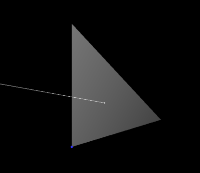

Figure 6.3 (without the feature)

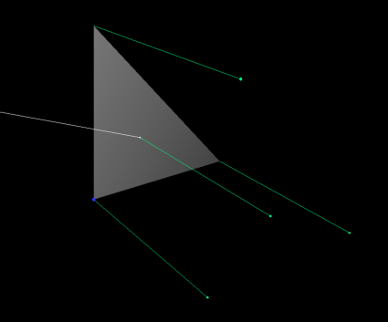

Figure 6.4

Here are some examples of the feature on different meshes:

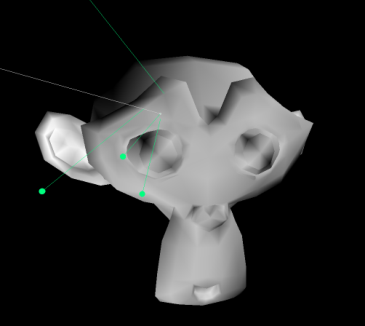

Figure 6.5

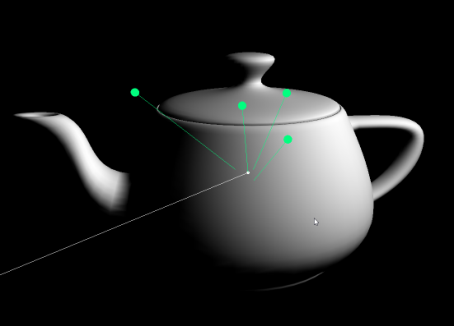

Figure 6.6

### 3.7 Texture Mapping

Texture mapping is used to calculate the color of a texture at a given intersection point. This way, we can add texture images to meshes. (Figures 8.1, 8.2)

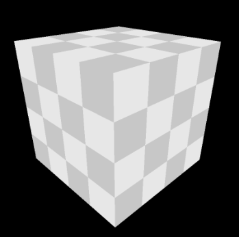

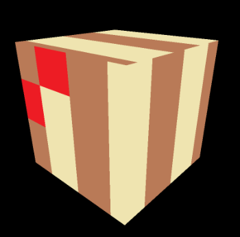

_Figure 8.1 / Figure 8.2_

#### Implementation
We have to obtain the texture coordinates that the intersection point is mapped to. We do this in _bounding_volume_hierarchy.cpp_ by first obtaining the barycentric coordinates of the point relative to the vertices of the triangle, with the _computeBarycentricCoord()_ method previously described.

These weights can then be used to interpolate between the texture coordinates of each vertex (which are defined in the material) using the _interpolateTexCoord()_ method, that multiplies each vertex position with their corresponding weight. (Figure 8.3)

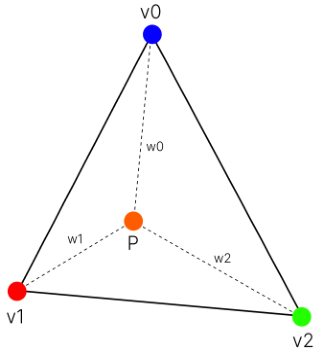

_Figure 8.3_

With these coordinates, the method acquireTexel() is called in order to retrieve the color value from the image array. Note that the image is fetched from the mesh material’s _kdTexture_ property.

The center of pixels have an offset of 0.5, thus, the center of the first pixel is located at (0.5, 0.5). Therefore, to map the texture coordinates into image coordinates, we use:

$$
x = \text{texCoord.x} \cdot \text{width} - 0.5
$$

$$
y = (1-\text{texCoord.y}) \cdot \text{height} - 0.5
$$

Note that the y axis is inverted (Figure 8.4), and we have to subtract from 1 for it to be correct (Figure 8.1).

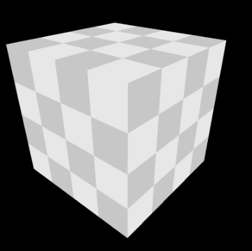

_Figure 8.4 (Inverse y axis)_

The final index can be calculated with the formula described in the lectures:

$$
\text{Index} = y \cdot \text{width} + x
$$

This value is clamped between 0 and the maximum index of the array so that no overflow happens.

#### Visual Debug:

A new scene called “Texture Mapping Debug” was created, which consists of a 2D plane textured with a 2x2 texture image (Figure 8.5). This way we can clearly see if a texture image is being correctly displayed. (Figures 8.6, 8.7). Note that we can only see these changes in ray-tracing mode.

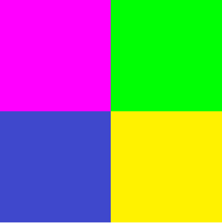

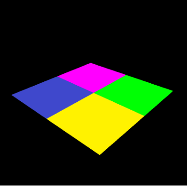

_Figure 8.5 / Figure 8.6_

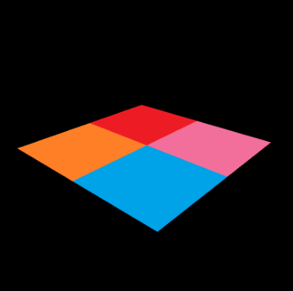

_Figure 8.7_

## 4. Extra Features

### 4.1 Bloom Filter

Bloom filtering is a post-processing effect, meaning that it will only get applied to the final rendered image. It consists in applying a filter (box filter, gaussian blur...) on a separate image selecting only the brightest components of the initial render, and then adding these two layers together. Visually, the brightest parts of an image will become brighter and give some illusion of glow. The difference can be seen in figures 9.1, 9.3 (no bloom filter) and 9.2, 9.4 (bloom enabled).

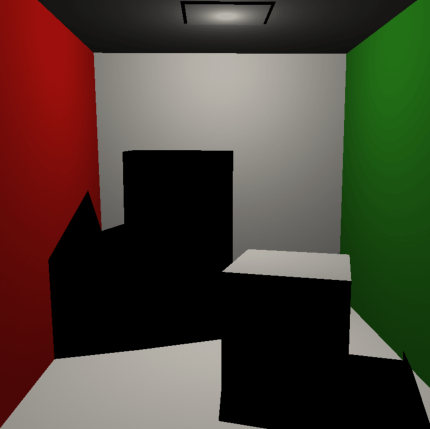

_Figure 9.1 / Figure 9.2_

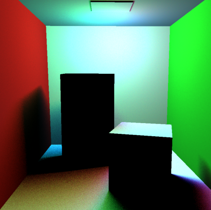

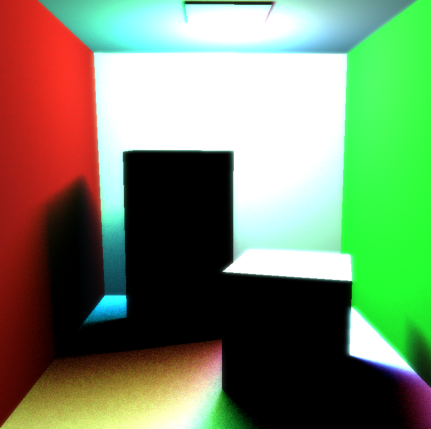

_Figure 9.3 / Figure 9.4_

#### Implementation:

The implementation for bloom filtering takes place inside the standard render method, since it gets applied once an image is rendered. This feature can be divided into 3 parts: thresholding, filtering and combining.

##### Thresholding

Firstly, we have to obtain an image containing only the bright parts from the original. Thus, it is also important to define what brightness is. An RGB color is made up of three components (red, green, blue). We could say that the brightness of a color is the average of these three values, and to produce the final image, remove any colors below a certain threshold. However, the method used in this project is called “relative luminance”, and it calculates the brightness of each color by using a linear combination of their three components:

$$
\text{Brightness} = 0.2126 R + 0.7152 G + 0.0722 B
$$

We can then calculate a final image by multiplying each pixel by its corresponding brightness. This way, dark parts will become darker and bright areas will become brighter, but not fully black (Figure 9.5).

_Figure 9.5_

##### Filtering

Once we have our thresholded image, we have to apply a filter over it. There are several filters we could implement (box filter, gaussian blur...)

Box filtering consists in taking the average of the colors that surround a certain pixel. For example, for a box filter of size 5, we will sample the closest 25 pixels (including the original) inside a 5x5 box and average the result (Figure 9.6).

_Figure 9.6_

In this case, all pixels will contribute equally to the final color. This is a valid method, however, in this project, gaussian blurring is used.

Instead of assigning each pixel the same weight, pixels that are closer to the center should have more impact on the final color, while those further away should contribute less (Figure 9.7).

_Figure 9.7 / Figure 9.8_

The weights of each pixel can be computed by using a gaussian distribution for a specific kernel size (Figure 9.8).

Note that this blurring technique has to construct a new image instead of overwriting the thresholded image, since values are being constantly changed. Another important thing to notice is that for a box size of 5, 25 pixels are fetched. Thus, since this action has to be performed for each pixel in the image, it quickly becomes clear that this is not very efficient. A 10x10 image will have to fetch 2500 pixels in total. What is done instead is divide this blurring process into two parts: horizontal blurring and vertical blurring.

These are called blur passes. We will first blur the image horizontally, meaning we will take the closest pixels to the center in the horizontal axis, perform the same calculation with only these pixels, and then do the same thing vertically over this new image (Figure 9.9).

_Figure 9.9_

This is much more efficient, since each pixel only retrieves n + n pixels instead of n· n.

Both blur passes are implemented in the same way, except one takes into account only horizontal coordinates and the other, vertical coordinates.

We first loop over each pixel in the image, fetch their corresponding closest n pixels and store their coordinates in an array. Furthermore, we call the method _blurFragment()_ , which takes this array and multiplies the fetched color at each coordinate by their corresponding gaussian weight.

For performance reasons, gaussian weights are pre-computed and embedded in the method, which means that the filter always has a size of 21x21. If we wanted to change this, we would have to update the values inside _blurFragment()_ .

A problem arises when we reach the edges of the screen (Figure 9.10). If we wanted to fetch the furthest pixels, we would be going out of the image. There are several ways to solve this, we could for example not take those pixels into account or just use the central pixel as their value, which is the case in this project. Nevertheless, this will have little to no effect over the final image, since these are typically of large sizes and the result will not be visible.

_Figure 9.10_

Furthermore, we can increase the intensity of the bloom filter by applying more blur passes to the filter. As we increase this value, the bloom layer will become more blurred.

##### Combining

After having calculated the blurred thresholded image, the final step is to sum it with the original. Thus, we will loop over the pixels of both and sum them together to achieve a final result. In figures 9.11 (original render), 9.12 (bloom layer) and 9.13 (final image) we can see what this combination looks like.

_Figure 9.11 (Original render) / Figure 9.12 (Bloom layer)_

_Figure 9.13 (Final image)_

#### Visual Debug:

Since bloom is a post-processing effect, it can only be visualized in rendered images, meaning in ray-tracing mode or as an export. However, there are a couple things we can implement to help visualize this effect. Most importantly, in the UI, the user is given the choice to enable bloom debug mode, which means that only the bloom layer (thresholded blurred image) will be shown when rendering. This way we can easily see which bright parts are being used or if the blur is correctly implemented (Figure 9.14, 9.15). Furthermore, the user also has the option to change the intensity of the bloom filter with a slider (Figure 9.16).

_Figure 9.14 / Figure 9.15_

_Figure 9.16_

### 4.2 Texture Filtering: Bilinear Interpolation

Bilinear interpolation in textures consists in blending between the colors of each pixel. Visually, this creates an effect in which a texture appears to be smooth and blurry instead of having sharp transitions (Figure 8.4, 8.6) between texels (Figures 10.1, 10.2).

_Figure 10.1 / Figure 10.2_

#### Implementation:

Bilinear interpolation can be implemented in _acquireTexel()_ , as with texture mapping. This feature will only have effect if both texture mapping and bilinear interpolation are enabled.

The process is similar to texture mapping. Given some texture coordinates, we first calculate their image coordinates with:

$$
x = \text{texCoord.x} \cdot \text{width} - 0.5
$$

$$
y = (1-\text{texCoord.y}) \cdot \text{height} - 0.5
$$

After that, we retrieve the four closest coordinates in the image (Figure 10.3), which will be used for interpolation. In this case, for point P, we are looking for points 0, 1, 2, 3.

_Figure 10.3_

To compute the x coordinates for points 0 and 1, we can floor the x coordinate of P, thus, if p.x was 0.3, it will now be 0. Once we have this value, the x coordinates for points 2 and 3 can be easily calculated by adding 1 to it.

Similarly, we can use the same method to achieve the y coordinates of these points by flooring the y value of p and then adding 1 to it. After performing these operations, we are left with the following points: 0(0, 0), 1(0, 1), 2(1, 1) and 3(1, 0).

To calculate the final color, we can use the bilinear interpolation formula:

$$
C = \alpha\beta C_0 + \alpha(1-\beta)C_1 + (1-\alpha)\beta C_3 + (1-\alpha)(1-\beta)C_4
$$

*The formula above preserves the report’s point indices, including its reference to point 4.*

As with texture mapping, to retrieve each individual color, we use the formula:

$$
\text{Index} = y \cdot \text{width} + x
$$

Note that this index should be clamped between 0 and the maximum index in the image array so that no overflow happens.

#### Visual Debug:

The visual debug for bilinear interpolation is similar to the one in texture mapping . The same scene called “Texture Mapping Debug” is used, where a 2D plane is textured with a 2x2 image. The user should enable texture mapping and bilinear interpolation to see the difference when texture filtering is on. (Figures 10.4, 10.5). Note that we can only see these visual changes in ray-tracing mode.

_Figure 10.4 / Figure 10.5_

## 5. References

[1] Marroquim Ricardo. Acceleration Data Structures, Technical University of Delft. 2022.

[2] Marroquim Ricardo. Open GL, Technical University of Delft. 2022.

[3] Marschner, Steve, and Peter Shirley. Fundamentals of Computer Graphics, Fourth Edition. Amsterdam, Netherlands, Amsterdam UP, 2016.

[4] Elmar Eisemann. Ray Tracing, Technical University of Delft. 2022.

[5] Relative luminance (2021) Wikipedia. Wikimedia Foundation. Available at: <https://en.wikipedia.org/wiki/Relative_luminance>

[6] Bhandari, P. (2022) _The standard normal distribution_ , _Scribbr_ . Available at: <https://www.scribbr.com/statistics/standard-normal-distribution/>

[7] _Motion user guide Apple Support_ . Available at: <https://support.apple.com/guide/motion/welcome/mac>

[8] Rodríguez, P.porV.M. (2019) _A gaussian blur material_ , _Inside The Pixels_ . Available at: <https://insidethepixels.wordpress.com/2019/09/30/a-gaussian-blur-material/>
